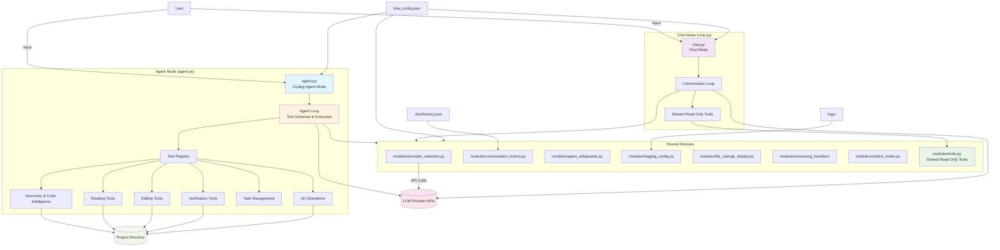

# Project Architecture

## Overview

Shai is a Python command-line assistant with two entry points. Agent mode combines a language model with local project tools; chat mode provides conversation without local project access.

## Architecture Overview (Text Summary)

The ASCII diagram above shows the high-level flow. Key points:

- **Two entry points**: `agent.py` (coding agent with tools) and `chat.py` (conversation only)
- **Shared modules** provide provider selection, conversation history, safeguards, logging, reasoning handlers, context metering, and read-only tools
- **Agent mode** adds mutating tools (editing, verification, Git, task management) with approval and bounded execution
- **Chat mode** uses only shared read-only tools from `modules/tools.py`
- **Configuration** (`shai_config.json`), history (`.shai/history.json`), and logs are persistent data

## Entry points

- **`agent.py`** manages the coding-agent loop, tool schemas, local tool execution, approvals, safeguards and verification.
- **`chat.py`** provides conversational mode without local file, Git or command-execution tools.
- **`modules/tools.py`** owns the shared read-only project-inspection tool implementations, schemas and dispatch used by chat mode and imported by agent mode. It receives the active project root through `configure_root()`; agent-only mutating and verification tools remain registered in `agent.py` because they depend on approval and bounded-execution policies.

The project root is the first command-line argument to `agent.py`; if omitted, the current working directory is used.

## Agent tool groups

### Discovery and code intelligence

`list_files`, `search_files`, `get_file_outline`, `find_symbol`, `find_references`, `get_project_map` and `get_test_map` help the model navigate a project. Python structure inspection uses the standard-library `ast` module. Reference search and test mapping are heuristic/textual, not compiler-grade semantic analysis.

### Reading

`read_file` returns bounded line chunks. Its `offset` and `limit` parameters allow the model to continue reading without repeating earlier chunks.

### Editing

`patch_file` performs an exact unique text replacement. A zero-match or multi-match result is surfaced as a tool error and recommends `replace_lines`; it is not counted as a successful operation. `replace_lines` replaces a 1-based inclusive line range and is the fallback when exact text matching is brittle. Three consecutive identical failed tool calls stop the current request instead of letting the model retry indefinitely. `edit_file` handles whole-file replacement.

Edits are previewed, approved according to configuration, validated where supported, backed up and atomically written.

### Verification

`run_checks` runs a selected check. `verify_changes` combines Python compilation with an optional test suite. `inspect_test_failure` extracts likely failure details from supplied test output. Command execution is bounded by configured timeout and output limits.

### Task progress and continuation

When a model returns a text-only response while the task plan still has pending or in-progress items, the agent now sends a bounded continuation instruction (at most two times) rather than silently treating the narration as task completion. The model must complete or explicitly block the remaining plan items. Completion and stop reasons are recorded in the log. The configured iteration count is capped at 80 to prevent pathological long-running requests.

`update_task_plan` maintains a lightweight in-memory checklist for the current agent session. The model can mark steps pending, in progress, completed or blocked. The checklist is session-local and is not persisted after exit.

## Shared modules

| Module | Responsibility |
|---|---|
| `modules/provider_selection.py` | Provider definitions, API-key environment variable names, model discovery, selection and persistence. |
| `modules/conversation_history.py` | Agent/chat history, prompt history and input navigation. |
| `modules/agent_safeguards.py` | Argument validation, repeat signatures, no-progress detection, result bounding and history compaction. |
| `modules/logging_config.py` | Run-based logs, retention, console settings and API payload redaction. |
| `modules/file_change_display.py` | Bounded diff previews. |
| `modules/reasoning_handlers/` | Provider-specific extraction and display of supported reasoning summaries. |
| `modules/context_meter.py` | Prompt-token estimation, provider usage normalization and context-window percentage formatting. |
| `modules/tools.py` | Shared read-only project tools, schemas, dispatch and project-root configuration. |

## Provider integration

Provider selection is shared by both modes. API requests use Python's standard-library HTTP facilities. OpenRouter, OpenAI, Gemini and Kilo use compatible chat/tool payloads where supported; Anthropic uses its Messages API format.

Reasoning handlers expose provider-supplied summaries when available. They do not expose hidden private chain-of-thought. The context meter estimates prompt size before a request and uses provider usage metadata for exact prompt/completion counts after a response. Percentages are shown only when the model context limit is known from provider metadata or configuration.

## Persistent data

- `shai_config.json`: runtime configuration and last-used provider/model.
- `.shai/history.json`: conversation history in the selected working project.
- `logs/`: diagnostic logs when file logging is enabled.
- `setup_keys.sh`: optional user-created shell file for API-key environment variables; keep it private and do not commit it.

## Tests

`test/` contains unit tests for the agent, chat, providers, safeguards, bounded execution, history, logging, reasoning handlers and tool functionality. `run_all_tests.sh` runs `unittest`, optionally runs `pytest`, and compiles source and test files.

## Pinned live status dashboard

During agent requests, Shai reserves a small terminal scroll region at the
bottom of interactive terminals. Conversation output scrolls in the body while
the status dashboard is redrawn in place. It shows the current phase, context
window usage, current/last tool and tool count, plus the latest task-plan items.
The dashboard is owned by `modules/live_status.py` and falls back to compact
status lines when stdout is not an interactive terminal or the terminal is too
short.

### Tool activity rendering

The live status module does not reserve terminal rows or freeze conversation
output. It collapses only each consecutive batch of tool calls into one
in-place-updated status line. Normal assistant text and warnings remain normal
scrolling chat output. Context-meter and task-plan values are maintained as
state without independently printing repetitive status messages.

## Modular package layout

The root scripts are now thin compatibility entry points. Existing commands remain
unchanged:

- `python agent.py [project_path]` loads `modules.engine.agent_runtime`.
- `python chat.py [project_path]` loads `modules.ui.chat_runtime`.

The compatibility entry points alias the runtime module namespace when imported,
so existing imports and test integrations that patch `agent` or `chat` continue
to operate on the live implementation.

### Engine and UI boundaries

- `modules/engine/agent_runtime.py` owns the coding-agent orchestration and tool
  lifecycle.
- `modules/engine/process_control.py` owns bounded subprocess execution,
  interruption monitoring, and Ctrl+D handling.
- `modules/ui/chat_runtime.py` owns the chat experience and provider response
  presentation.
- `modules/ui/spinner.py` owns the terminal spinner component.
- Existing shared modules under `modules/` continue to own provider selection,
  conversation history, context metering, safeguards, logging, reasoning
  extraction, terminal styling, and live status presentation.

### Command organization

`modules/commands/` separates command aliases, canonical command descriptions,
help text, and command normalization. The interactive agent loop consumes the
normalizer while preserving command arguments such as `/project <path>` and
`/exec <command>`.

### Tool organization

The shared read-only project tools are divided by responsibility:

- `modules/tools/common.py`: project root and path-safety primitives.
- `modules/tools/filesystem.py`: listing, reading, and text search.
- `modules/tools/git.py`: Git status and diff inspection.
- `modules/tools/inspection.py`: AST outlines, symbol/reference lookup,
  project/test maps, and test-failure inspection.
- `modules/tools/schemas.py`: read-only tool schemas and dispatch registry.
- `modules/tools/__init__.py` and `modules/tools.py`: stable compatibility
  exports for existing imports.

### Configuration compatibility

No configuration values, defaults, keys, or configuration files were changed.
Both runtime modules resolve `shai_config.json` from the project root, exactly
as before. The configuration file in the refactor archive is byte-for-byte
identical to the supplied source archive.
