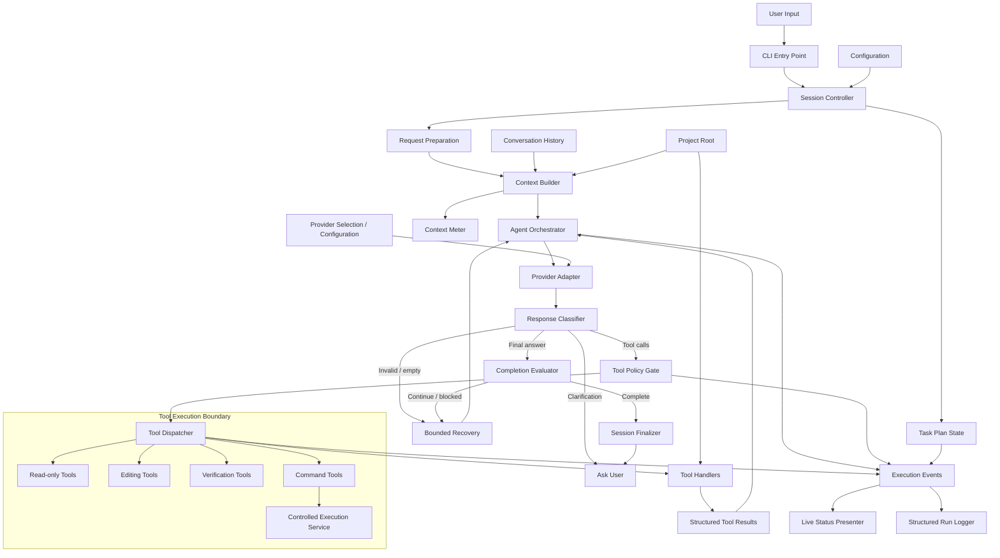
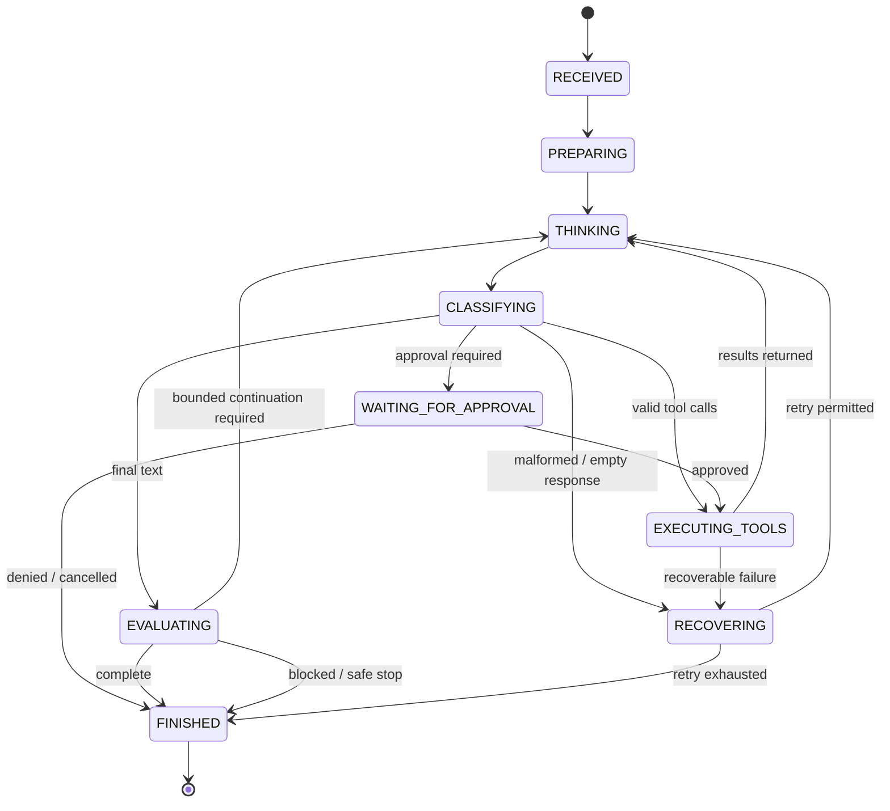

# Shai — Execution Flow Architecture

> **Status: Active architectural blueprint (Phased implementation in progress).**
> - **Delivered:** Domain module decomposition under `modules/engine/` (10 extracted modules + `agent_runtime.py` facade), restricted `os_command` execution, `shai_command` deterministic routing, centralized project path access control, and transient in-place tool status updates (`\r` + erase-line).
> - **In Progress / Remaining:** Formal request session object (`session.py`), explicit lifecycle state machine, event-driven presenter bus, and unified model-turn/tool-result contracts.


## 1. Purpose

This document proposes an improved end-to-end execution flow for Shai. It
complements:

- [`../ARCHITECTURE.md`](../ARCHITECTURE.md) — current system structure and module
  responsibilities.
- [`../SHAI_COMMAND.md`](../SHAI_COMMAND.md) — mapping natural language
  to existing commands.
- [`../OS_COMMAND.md`](../OS_COMMAND.md) —
  security policy and process execution boundaries.

The goal is not to replace Shai's existing capabilities or change its public
CLI. The goal is to make the runtime easier to understand, test, extend, and
recover when a model response, tool, or workflow behaves unexpectedly.

The main architectural recommendation is:

> Treat each user request as a managed execution session with explicit phases,
> typed state, bounded transitions, and one orchestration owner. Keep model
> communication, tool execution, policy decisions, task progress, and terminal
> presentation as separate responsibilities.

This document describes a target design. It is not a claim that every
proposed module or interface already exists.

## 2. Problems this design addresses

The current architecture already has useful boundaries: separate agent and
chat runtimes, shared read-only tools, bounded process execution through
`os_command`, safeguards,
task tracking, context metering, and live status rendering.

The next improvement should focus on the flow between those components.

Typical risks in an evolving agent loop include:

1. **Orchestration concentration.** The runtime can accumulate request parsing,
   provider calls, tool dispatch, retry decisions, task continuation, output
   rendering, and error handling in one large control loop.
2. **Implicit state.** The current phase, pending approvals, tool results,
   task status, and stop reason can be spread across local variables and
   module-level state.
3. **Unclear transition rules.** Text-only responses, multiple tool calls,
   tool failures, interrupted requests, and pending tasks can take different
   paths without one explicit state-transition policy.
4. **Inconsistent error semantics.** Provider errors, tool errors, policy
   rejections, command failures, and cancellation should not be treated as
   interchangeable failures.
5. **Repeated or stale work.** A model may retry an unchanged failed tool call,
   issue duplicate mutations, continue from stale repository state, or claim
   completion while plan items remain unfinished.
6. **UI coupling.** Terminal output and status updates should not determine
   whether an operation succeeded or whether the agent continues.
7. **Hard-to-test behavior.** When policy, orchestration, and presentation are
   coupled, tests need to exercise large portions of the runtime to verify one
   decision.

The target flow makes these decisions explicit and independently testable.

## 3. Target architecture



### Architectural boundaries

| Component | Owns | Must not own |
|---|---|---|
| CLI entry point | Arguments, startup, shutdown | Agent loop or tool implementation |
| Session controller | Request lifecycle and session resources | Provider-specific payload formatting |
| Context builder | Prompt assembly, history selection, context budget | Tool execution |
| Agent orchestrator | Model/tool cycle and transition decisions | Terminal rendering or subprocess details |
| Provider adapter | Provider API formats, streaming, response normalization | Tool authorization |
| Response classifier | Classifying normalized model output | Executing tools |
| Tool policy gate | Availability, mode, approval, risk decisions | Tool implementation |
| Tool dispatcher | Resolving and invoking registered handlers | Model prompting or direct terminal UI |
| Tool handlers | One bounded capability each | Agent-loop continuation |
| `os_command` / controlled execution service | Validated subprocess lifecycle | `shai_command` intent recognition |
| Task plan manager | Task state and completion criteria | Deciding whether a model response is valid |
| Event publisher | Emitting lifecycle events | Owning workflow state |
| Status presenter | Rendering current state | Deciding execution success |
| Run logger | Persisting diagnostic events | Changing execution behavior |

## 4. One request, one managed session

Every user request should create a request-scoped execution session. A session
contains the state needed to process the request and produce a reliable result.

Suggested structure:

```python
@dataclass
class ExecutionSession:
    request_id: str
    session_id: str
    project_root: Path
    mode: str
    user_message: str
    status: str
    iteration: int
    max_iterations: int
    task_plan: TaskPlan
    conversation: ConversationState
    context: ContextState
    pending_approval: ApprovalRequest | None
    last_tool_results: list[ToolResult]
    stop_reason: str | None
```

This is illustrative. Use the project's existing data conventions where
possible; do not introduce duplicate copies of conversation history or
configuration.

### State ownership

- Session-scoped values belong to the session controller or session object.
- Immutable application configuration is loaded and validated at startup.
- Tool execution state belongs to the tool runner.
- Provider request/response state belongs to the provider adapter.
- Presentation state is derived from execution events.
- Persistent conversation history remains owned by the history module.
- The task plan remains session-local unless persistence is deliberately
  introduced as a separate feature.

Avoid hidden mutable global state for values that vary between requests.

## 5. Explicit lifecycle and state machine

Use a small set of explicit lifecycle states. Do not let a collection of
booleans implicitly represent the workflow.



Recommended states:

| State | Meaning |
|---|---|
| `RECEIVED` | User input has been accepted |
| `PREPARING` | Resolve mode, configuration, project root and request context |
| `THINKING` | Waiting for a provider response |
| `CLASSIFYING` | Normalize and classify the response |
| `WAITING_FOR_APPROVAL` | A policy decision requires user authorization |
| `EXECUTING_TOOLS` | One approved batch of tool calls is being processed |
| `EVALUATING` | Assess final response against task and stop conditions |
| `RECOVERING` | Apply a bounded recovery rule |
| `FINISHED` | Request has a terminal outcome |

A state transition should be performed by the orchestrator/session controller,
not by an individual tool handler or the terminal presenter.

### Terminal outcomes

Use explicit terminal outcomes rather than a generic `done` boolean:

- `completed`
- `completed_with_warnings`
- `needs_user_input`
- `blocked`
- `cancelled`
- `timed_out`
- `iteration_limit`
- `provider_error`
- `internal_error`

A terminal outcome should include a human-readable explanation and, where
relevant, the last safe checkpoint.

## 6. Recommended request flow

### Phase A — Receive and prepare

1. Accept the user's message.
2. Resolve the requested mode and project root.
3. Load validated configuration and relevant conversation history.
4. Create the request-scoped session and request ID.
5. Determine whether the request is conversational, a task, or an explicit
   command request.
6. Initialize the task plan only when planning is useful; do not force a
   checklist for trivial requests.
7. Emit a `request_started` event.

Do not perform repository mutations during request preparation.

### Phase B — Build context

The context builder should assemble the provider input from distinct sources:

1. System and application instructions.
2. Mode-specific instructions and enabled tool schemas.
3. Relevant conversation history.
4. Current user request.
5. Task-plan summary, if present.
6. Recent tool results needed for the next decision.
7. A compact context-usage summary where useful.

The context builder should own truncation and compaction policy. It should
preserve recent user instructions and the minimum information needed to
continue the task.

Do not append every historical tool result indefinitely. Retain a concise
summary plus the exact recent results needed for the next model turn.

### Phase C — Request a model response

1. The orchestrator asks the provider adapter for a response.
2. The provider adapter handles provider-specific request formatting,
   streaming, retries for safe transport failures, and response normalization.
3. The adapter returns a common response object.
4. The orchestrator records usage and updates context state.
5. The response classifier determines whether the result contains tool calls,
   final text, a clarification, or an invalid/empty response.

The provider adapter must not execute tools. It only communicates with the
provider and normalizes the response.

### Phase D — Classify and validate

Normalize provider output into a common internal representation:

```python
ModelTurn(
    text="...",
    tool_calls=[...],
    finish_reason="tool_calls",
    usage=Usage(prompt_tokens=..., completion_tokens=...),
    provider_metadata={...}
)
```

Then validate:

- Is the response structurally valid?
- Are tool names registered and enabled?
- Are arguments valid against the tool schema?
- Is the tool available in the current mode?
- Is the call allowed by policy?
- Does the response contain both final text and tool calls, and if so, what
  behavior does the provider contract define?
- Is this an actual request for clarification?

Do not pass unvalidated provider output directly to handlers.

### Phase E — Authorize and execute tools

For each tool call:

1. Resolve the tool from the registry.
2. Validate the arguments.
3. Check mode and preconditions.
4. Classify the operation and evaluate policy.
5. Request approval if required.
6. Execute through the registered handler.
7. Convert success or failure into a structured `ToolResult`.
8. Append the result to the conversation in the provider-compatible format.
9. Emit lifecycle events and update status.

Tool execution must be bounded. A tool handler must not start a new model
conversation or recursively call the agent loop.

#### Tool batch behavior

Define batch semantics explicitly:

- Validate all calls in a response before starting the batch.
- Independent read-only calls may run concurrently if the tool registry marks
  them safe for concurrency.
- Mutating calls should be serialized unless a reviewed workflow defines safe
  ordering.
- Calls with dependencies must execute in dependency order.
- If one call fails, do not assume the remaining calls should run. Use declared
  batch semantics; otherwise stop the batch and return the failure.
- Never run duplicate non-idempotent calls merely because the provider
  repeated a tool-call ID or the response was replayed.

Keep concurrency conservative until handlers have explicit concurrency
metadata and tests.

### Phase F — Evaluate progress and completion

A text-only response is not automatically proof that the task is complete.

When a task plan exists, evaluate:

- Are all required plan items complete?
- Are any items blocked or waiting for user input?
- Does the response explicitly claim completion?
- Is there evidence from tools or verification for claims that require it?
- Did the user ask for an explanation rather than an implementation?
- Has the iteration or recovery budget been exhausted?

If the model stops while required work remains, use a bounded continuation
instruction that names the unfinished items and the observed state. The
continuation budget must be finite and configurable. The existing maximum of
two task continuations can remain the initial default until evaluation data
supports a change.

Do not repeatedly prompt the model with the same generic "continue" message.
Do not force completion when a task is blocked or requires user input.

### Phase G — Finalize

1. Determine the terminal outcome and stop reason.
2. Persist conversation history according to existing policy.
3. Flush structured logs.
4. Release terminal UI resources and stop status updates.
5. Return the final user-facing response.
6. Clear request-scoped state and temporary resources.

Finalization must run for success, failure, cancellation, timeout, and
unexpected exceptions. Use `try/finally` or a dedicated session cleanup
mechanism so the terminal status region and child processes are not left
behind.

## 7. Tool contracts and result handling

Every tool should have a stable contract.

Suggested result type:

```python
@dataclass
class ToolResult:
    tool_call_id: str
    tool_name: str
    status: str  # success, error, rejected, approval_required, cancelled
    content: str
    error_code: str | None = None
    retryable: bool = False
    duration_ms: int | None = None
    metadata: dict = field(default_factory=dict)
```

Rules:

- `success` means the requested operation completed successfully.
- `error` means the handler ran but failed.
- `rejected` means validation or policy prevented execution.
- `approval_required` means the operation has not run yet.
- `cancelled` means execution was interrupted.
- A tool error must be returned to the model as a tool error, not as a
  successful result containing an error-shaped string.
- Keep diagnostic details for logs, but return concise, actionable information
  to the model.
- Bound result size before adding it to conversation history.
- Do not silently discard stderr or structured failure information.
- Never convert a rejected or failed tool call into a successful completion.

### Error categories

| Category | Example | Default response |
|---|---|---|
| Validation | Invalid argument or path | Do not execute; return actionable error |
| Policy | Tool disabled or operation denied | Do not execute; explain restriction |
| Approval | User confirmation required | Pause until decision |
| Tool runtime | File read or patch failure | Return structured error |
| Process | Non-zero exit, timeout | Return exit details and bounded output |
| Provider | API error, rate limit | Safe bounded retry only where appropriate |
| Protocol | Malformed tool call or response | Bounded recovery, then stop |
| Internal | Unexpected exception | Log traceback, return safe failure |

## 8. Retry, recovery, and loop protection

Retries should be based on error type and operation semantics, not on a generic
instruction to try again.

### Recovery policy

| Situation | Recovery |
|---|---|
| Invalid tool arguments | Return validation error; model may correct once |
| Exact repeated failed call | Detect repeat signature and stop repeated attempts |
| Transient provider transport error | Small bounded retry with backoff |
| Rate limit | Respect provider retry guidance within a bounded deadline |
| Tool timeout | Do not automatically retry a mutation |
| Non-zero command exit | Return output; model decides next safe step |
| Policy rejection | Do not retry unless user changes authorization/configuration |
| Malformed provider response | One bounded recovery attempt, then fail safely |
| Text response with unfinished plan | Bounded task continuation |
| User cancellation | Stop immediately and clean up |

### Loop guards

Keep independent limits for:

- Maximum model iterations per request.
- Maximum tool calls per request.
- Maximum repeated identical tool calls.
- Maximum consecutive recovery attempts.
- Maximum task continuations.
- Maximum wall-clock duration.
- Maximum concurrent child processes.
- Maximum accumulated tool-result bytes.

A single iteration cap is not sufficient: a model can issue many tool calls in
one turn, and a child process can outlive the model iteration.

Use a stable repeat signature based on the canonical tool name and normalized
arguments. For commands, include the canonical working directory and
execution-relevant policy fields. Do not use unstable serialized metadata as
the only repeat detector.

Do not retry a non-idempotent action after an ambiguous timeout. Inspect the
resulting state first.

## 9. Task plan as workflow state

The task plan is a progress aid, not an independent authority to execute.

Suggested item states:

- `pending`
- `in_progress`
- `completed`
- `blocked`
- `skipped`

Each item should have a stable ID and a concise completion condition.

```python
TaskItem(
    id="verify-tests",
    description="Run the relevant test suite",
    status="pending",
    completion_criteria="The selected test suite completes successfully.",
    depends_on=["implement-change"]
)
```

Rules:

- The model may propose or update task status, but the application validates
  state transitions.
- A task cannot be marked completed solely to bypass required verification.
- Blocked items need a reason.
- Dependent tasks cannot start until their prerequisites are complete.
- A plan update must not silently create permission to run new tools.
- Keep the plan session-local unless persistent task tracking is explicitly
  designed.
- Do not create plans for small conversational requests.

## 10. Context management

Context management should be a first-class phase, not scattered prompt
trimming.

### Context builder responsibilities

- Estimate the request size before provider submission.
- Include the configured system prompt and enabled tool schemas in estimates.
- Reserve output headroom for the provider response.
- Compact older history when approaching the configured budget.
- Preserve the current user request, recent tool call/result pairs, active
  task-plan state, and critical decisions.
- Avoid duplicating large file contents or repeated command output.
- Use provider usage metadata when available to reconcile estimates.

### Context meter responsibilities

- Display estimated prompt usage before a request.
- Display provider-reported prompt and completion usage after a response.
- Show percentages only when the model context limit is known.
- Distinguish estimated values from provider-reported values.
- Never claim an exact context percentage from an uncalibrated estimate.

The context meter is observational. It must not mutate conversation history
or determine task completion.

## 11. Events, logging, and live status

Use a small internal event interface to decouple runtime behavior from the
terminal UI and logger.

Example events:

```text
request_started
phase_changed
provider_request_started
provider_response_received
tool_call_received
tool_validation_failed
approval_requested
approval_resolved
tool_started
tool_completed
tool_failed
task_plan_updated
context_updated
recovery_started
request_finished
```

An event should include a request ID, timestamp, event type, and a bounded
payload. Avoid secrets and unnecessary file contents.

### Live status presenter

The live status dashboard should subscribe to events or read a stable
presentation snapshot. It should display state, not own it.

It may show:

- Current phase.
- Context usage and whether it is estimated.
- Current or most recent tool.
- Completed/total tool count.
- Current task-plan items.
- Approval-waiting or cancellation state.

It must not:

- Print duplicate status lines for every internal state update.
- Interleave status redraws with ordinary assistant text.
- Swallow warnings, errors, or tool output.
- Decide whether the agent should continue.
- Prevent output when the terminal is non-interactive or too short.

Retain the delivered transient in-place tool activity line (`\r` + erase-line)
and non-TTY compact fallback (per `docs/TERMINAL_OUTPUT.md`), but make the
presenter consume normalized events rather than being called from many
unrelated branches in the agent loop.

### Logging

Use structured run events with a consistent request ID. Keep user-facing
output, provider diagnostics, and tool output distinct.

Record:

- Request start/end and terminal outcome.
- Phase transitions and iteration counts.
- Provider and model identifiers, latency, and usage when available.
- Tool name, bounded arguments or redacted argument summary, status, duration,
  and error code.
- Approval decisions and policy rejections.
- Recovery and stop reasons.
- Output truncation and cancellation.

Do not log API keys, credential values, or unrestricted sensitive file
contents. Preserve enough information to reproduce control-flow failures
without leaking secrets.

## 12. Suggested package organization

Avoid splitting code into many tiny modules before the responsibilities and
contracts are stable. Extract modules around coherent ownership boundaries.

A possible target layout:

```text
modules/
├── engine/
│   ├── agent_runtime.py        # Thin composition / compatibility facade
│   ├── session.py              # Request-scoped state and lifecycle
│   ├── orchestrator.py         # Model/tool loop and state transitions
│   ├── response_classifier.py  # Normalized response classification
│   ├── completion.py           # Task completion and stop evaluation
│   └── recovery.py             # Retry and loop-guard decisions
│
├── providers/
│   ├── adapter.py              # Common provider interface
│   ├── response.py             # Normalized provider response types
│   └── ...                     # Provider-specific implementations
│
├── tools/
│   ├── registry.py              # Canonical tool definitions
│   ├── dispatcher.py            # Validation and handler invocation
│   ├── results.py               # Tool result contract
│   ├── common.py
│   ├── filesystem.py
│   ├── git.py
│   └── ...
│
├── commands/
│   ├── registry.py              # Canonical slash-command metadata
│   ├── normalizer.py
│   └── dispatcher.py
│
├── execution/
│   ├── policy.py                # Risk and permission decisions
│   ├── process_runner.py        # Bounded subprocess lifecycle
│   └── approval.py              # Exact-request approval lifecycle
│
├── workflow/
│   ├── task_plan.py             # Plan state and transition validation
│   └── budgets.py               # Iteration, time, and result budgets
│
├── context/
│   ├── builder.py               # Prompt/context assembly
│   ├── compaction.py            # History compaction
│   └── meter.py                 # Context and token usage
│
├── events/
│   ├── models.py                # Event types and payloads
│   └── bus.py                   # In-process event dispatch
│
└── ui/
    ├── agent_cli.py             # Interactive agent terminal REPL (extracted from engine)
    ├── chat_runtime.py          # Interactive chat terminal REPL
    ├── spinner.py               # Non-blocking terminal activity spinner
    └── ...
```

This is a logical target, not a mandatory file-creation checklist. Reuse
existing modules such as `agent_safeguards.py`, `context_meter.py`,
`conversation_history.py`, `live_status.py`, and `process_control.py` where
their responsibilities already fit. Avoid duplicate registries or competing
implementations.

### Keep compatibility entry points

Preserve:

- `python agent.py [project_path]`
- `python chat.py [project_path]`
- Existing slash-command syntax and argument behavior.
- Existing configuration keys and defaults unless a separate migration is
  designed.
- Existing imports and test integrations that patch the compatibility
  `agent` or `chat` namespaces.

Refactoring the internals must not require users to change their workflow.

## 13. Chat mode and agent mode

Keep the shared conversation/provider infrastructure separate from
agent-only capabilities.

### Chat mode

- No project mutation tools.
- No Git mutation tools.
- No command-execution tools.
- Only the explicitly supported shared read-only capabilities.
- Same provider normalization, history, logging, and context principles where
  appropriate.

### Agent mode

- Project-aware context and tool schemas.
- Read-only inspection, editing, verification, task management, and Git
  operations.
- Approval and execution policy for side effects.
- Bounded orchestration and task completion evaluation.

Do not make chat mode import the full agent runtime merely to reuse a small
utility. Extract genuinely shared primitives into narrow shared modules.

## 14. Testing strategy

Test each boundary independently, then test the end-to-end flow.

### Unit tests

**Session and state machine**
- Every valid transition is accepted.
- Invalid transitions are rejected.
- Every terminal outcome runs cleanup.
- Cancellation and exceptions cannot leave the session active.

**Response classifier**
- Text-only response.
- One tool call.
- Multiple tool calls.
- Empty response.
- Malformed tool arguments.
- Unknown tool.
- Mixed text and tool calls.
- Provider-specific response normalized to the same common contract.

**Tool dispatcher**
- Unknown/disabled tool rejection.
- Schema validation.
- Mode restrictions.
- Policy rejection.
- Approval required.
- Handler success and failure.
- Result truncation.
- Duplicate call handling.

**Recovery and budgets**
- Repeated identical failures stop.
- Provider retry is bounded.
- Mutation timeout does not trigger automatic retry.
- Iteration, time, tool-call, and output budgets are enforced.
- Continuation stops at its configured limit.

**Task plan**
- Valid and invalid status transitions.
- Dependency ordering.
- Blocked item handling.
- Completion evaluation with pending items.
- No plan for simple conversational turns.

**Events and UI**
- Event emission does not alter execution outcome.
- Status rendering does not swallow normal output.
- Non-TTY fallback works.
- Terminal rows are restored after every terminal outcome.

### Integration tests

1. Simple chat request completes without agent tools.
2. Simple agent question uses read-only tools when needed.
3. Multi-tool request returns results to the model in the correct order.
4. Edit request follows preview, approval, write, and verification policy.
5. Failed patch returns a tool error and does not claim success.
6. Verification failure is surfaced and can lead to a bounded correction cycle.
7. Text-only response with pending tasks triggers bounded continuation.
8. Blocked task produces a clear terminal outcome.
9. Cancellation terminates active child processes and restores the terminal.
10. Provider failure is distinguishable from tool failure.
11. Repeated tool-call errors do not cause an infinite loop.
12. Chat mode cannot access agent-only mutation or execution tools.

### Regression tests

- Existing command aliases and parameters remain unchanged.
- Existing compatibility imports continue to work.
- Existing configuration files load without migration.
- Existing log formats or consumers remain compatible where required.
- Existing task-plan and live-status behavior remains available.
- All current tests continue to pass.

## 15. Incremental refactoring plan

Do not rewrite the monolithic runtime in one pass. Extract and test one
responsibility at a time while keeping behavior stable.

### Phase 0 — Baseline

- Run the complete existing test suite.
- Record current agent-loop behavior and public interfaces.
- Identify all mutable state and all direct provider/tool/process calls.
- Capture representative logs for success, tool failure, provider failure,
  continuation, cancellation, and timeout.
- Add characterization tests before changing control flow.

### Phase 1 — Define contracts

- Introduce normalized model-turn and tool-result structures.
- Define lifecycle states and terminal outcomes.
- Define event names and payloads.
- Document current tool and command registry behavior.
- Keep the existing runtime as the composition point.

**Exit condition:** contracts are tested and existing behavior is unchanged.

### Phase 2 — Extract response classification

- Move provider-response interpretation out of the main loop.
- Normalize tool calls and final text.
- Reject malformed and unknown calls before dispatch.
- Add unit tests for provider response variants.

**Exit condition:** the runtime consumes one normalized response type.

### Phase 3 — Extract tool dispatch

- Centralize registry lookup, argument validation, mode checks, and result
  conversion.
- Ensure all tools return structured results.
- Route subprocess-backed tools through the controlled execution service.
- Remove direct handler invocation from the orchestration loop.

**Exit condition:** every tool call follows one dispatch path.

### Phase 4 — Extract session and orchestration

- Move request-scoped state into a session object.
- Move transition decisions into an orchestrator.
- Keep `agent_runtime.py` as a thin facade/composition layer.
- Add explicit terminal outcomes and guaranteed cleanup.

**Exit condition:** the orchestrator can be tested with fake provider and tool
implementations, without a real terminal or network connection.

### Phase 5 — Extract completion and recovery

- Centralize task-plan evaluation.
- Separate provider retries, tool retries, and task continuation.
- Add independent budgets and repeat guards.
- Make stop reasons explicit in logs.

**Exit condition:** no unbounded retry or continuation path remains.

### Phase 6 — Event-driven presentation and observability

- Emit normalized lifecycle events.
- Make live status and logging consume events.
- Remove direct status-rendering calls from unrelated execution branches.
- Preserve the pinned status dashboard and fallback behavior.

**Exit condition:** disabling the live dashboard does not change agent behavior.

### Phase 7 — Simplify and harden

- Remove obsolete duplicated logic.
- Check import cycles and compatibility aliases.
- Add concurrency only for explicitly safe tools.
- Run full regression, fault-injection, and end-to-end tests.
- Update architecture and developer documentation to describe implemented
  behavior, not aspirational behavior.

## 16. Acceptance criteria and implementation progress

Current verification status of execution-flow architecture goals:

- [x] **Domain module boundaries established:** Modular engine extracted into `modules/engine/` (`configuration`, `project_inspection`, `task_plan`, `git_operations`, `file_editing`, `provider_api`, `tool_execution`, `tool_presentation`, `history_recovery`, `model_orchestration`).
- [x] **Compatibility entry points preserved:** `agent.py` and `modules/engine/agent_runtime.py` preserve existing CLI, interactive commands, and monkeypatch surfaces.
- [x] **Chat mode isolation:** Chat mode cannot access agent-only tools, OS commands, or file mutations.
- [x] **Controlled process runner:** Bounded output capture, stdout/stderr caps, timeouts, and process-tree termination implemented in `process_control.py`.
- [x] **Project path access gates:** Centralized access policy and glob matching enforced in `modules/tools/common.py` prior to tool execution.
- [x] **Transient terminal output:** Single carriage-return-updated activity line avoiding terminal-scroll lockouts on narrow terminals (e.g. iSH).
- [ ] **Request session encapsulation:** Each user request has one identifiable session instance and unique request ID (`session.py`).
- [ ] **Explicit lifecycle state machine:** Typed transition rules between `PREPARE`, `PROMPT_BUILD`, `AWAIT_MODEL`, `VALIDATE_RESPONSE`, `EXECUTE_TOOLS`, `EVALUATE_CONTINUATION`, `SUSPENDED`, and `FINALIZE`.
- [ ] **Normalized model-turn representation:** Unified model response objects decouples provider-specific serialization from orchestrator decisions.
- [ ] **Unified tool dispatcher:** Single gate ensuring all tool calls (read-only, mutating, OS commands) return standard `ToolResult` objects with typed error categories.
- [ ] **Event-driven observability:** Event bus (`events/bus.py`) decouples UI presenters, live status, and logging from core loop branches.
- [ ] **Independent task evaluation:** Continuation rules operate strictly on validated task-plan state without relying on model self-narration.
- [ ] **Full mock testability:** Orchestrator can be comprehensively tested with fake provider and fake tool harnesses without terminal or network mocks.

## 17. Decisions to make before implementation

Inspect the current code and settle these questions before finalizing the
refactor:

1. Which parts of `agent_runtime.py` currently own provider calls, tool
   dispatch, continuation, approvals, task plans, and rendering?
2. Are tool calls executed sequentially today, and do any tools rely on that
   ordering?
3. What provider response variants need normalization across supported
   providers?
4. How are pending approvals represented across an interrupted request?
5. What is the current behavior when a response contains both text and tool
   calls?
6. Which tool results must be retained verbatim for a later model turn?
7. Which state is module-global and could leak between requests?
8. How does cancellation propagate from the terminal to provider requests and
   child processes?
9. Which log consumers depend on the current log structure?
10. Which compatibility imports and monkeypatch points are relied upon by
    tests or external scripts?

Do not guess these answers. Use code inspection and characterization tests.

## 18. Final recommendation

Prioritize **control-flow clarity before further feature growth**.

The most valuable first milestone is not creating the entire proposed package
tree. It is making the existing runtime follow a simple, testable sequence:

```text
Receive request
    -> Prepare session and context
    -> Request model response
    -> Normalize and classify response
    -> Validate and authorize tool calls
    -> Execute tools and return structured results
    -> Evaluate task progress
    -> Continue within explicit budgets or finalize
```

Once that sequence is owned by a small orchestrator and all side effects pass
through defined boundaries, Shai can add commands, tools, providers, and
workflow features without making the core agent loop more monolithic.
